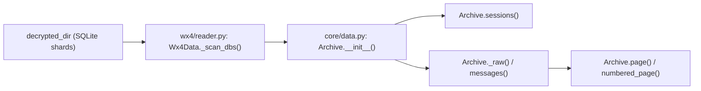
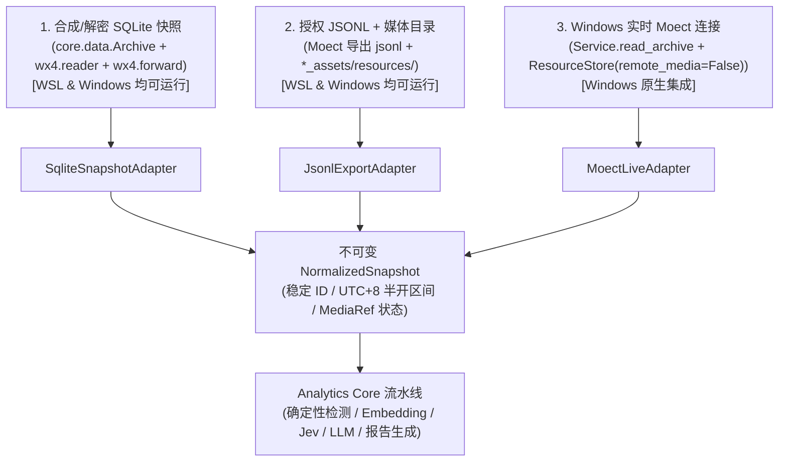

# CL-00 Phase 0 源码审计与基线报告

> 状态：Phase 0 审计完成（WSL 侧静态审计与跨平台验证已完成；Windows 原生构建、WebView2 GUI、真实微信 4.x 接入与授权样本媒体覆盖度验证**尚未在 Windows 环境执行，标记为 BLOCKED**）。
> 约束声明：本阶段仅做调查与基线固化，未修改任何 Moect 业务代码，未提前实现 Jev/LLM/分析功能，未提交任何真实聊天记录、个人身份信息或密钥。

---

## 1. 基线元数据与仓库声明

| 项目 | 实际观测值 | 证据位置 |
| --- | --- | --- |
| 上游仓库 | `https://github.com/mofan6/Moect` | `git remote -v`；`core/version.py:5` |
| 上游基线提交 | `993f4e8`（`Release Moect 1.3.2`） | `git log`；`core/version.py:1` (`VERSION = '1.3.2'`) |
| 当前 Fork 仓库 | `https://github.com/yuanbaoerer/ChatLens.git` | `git remote -v` |
| Fork 基线提交 | `51e2122`（Merge PR #1 `4245049`，含 `AGENTS.md` 与 `docs/chatlens/*`） | `git log -n 3` |
| 命名差异提示 | 规划文档（`00-product-design.md:3`、`11-upstream-strategy.md:3`、`AGENTS.md:1`）写作 `ChetLens`，实际 GitHub remote 为 `yuanbaoerer/ChatLens.git`；打包命名定案前需统一确认 | `git remote -v` |
| 开源协议 | GPL-3.0，保留 `LICENSE`、`THIRD_PARTY_NOTICES.md`、`THIRD_PARTY_LICENSES/` | `LICENSE`、`build.py:55-56,79` |
| 目标运行环境 | Windows 10 1809 (`10.0.17763`) / Windows 11 x64 + WebView2 Runtime + PC 微信 4.x (`Weixin.exe`) | `README.md:76-77`、`installer/Moect.iss:17-19`、`wx4/__init__.py:3-15` |
| 审计执行环境（本报告） | WSL2 Linux `6.18.58.1-microsoft-standard-WSL2` x64；ext4 文件系统；Python `3.11.15`（uv）& `3.12.3`；Node `v26.13.1` / npm `11.20.0` | 第 7 节实测命令输出 |

---

## 2. Moect 代码结构、启动流程、构建流程与依赖关系

### 2.1 目录与模块总览

```text
ChatLens/
├── edge_app.py              # 主发行桌面入口：pywebview + WebView2 + WinForms NativeFrame (Windows-only)
├── app.py                   # 保留的旧桌面入口：PySide6 QtWebEngine + QWebChannel (不进入发行包)
├── publisher_app.py         # 独立作者发布中心入口 (与聊天核心隔离，不进入 Moect 发行包)
├── updater.py               # 独立外部更新器 (PyInstaller --onefile -> MoectUpdater.exe)
├── build.py                 # Windows 发行目录构建脚本 (dist/Moect/Moect.exe + MoectUpdater.exe)
├── build_publisher.py       # 作者发布中心打包脚本
├── requirements.txt         # Windows 完整 Python 依赖清单 (13 项锁定版本)
├── windows.manifest         # Windows DPI / 兼容清单
├── core/                    # 44 个应用核心模块 (Service、只读数据层、导出、媒体解码、存储、在线通道、窗口封装)
├── wx4/                     # 13 个微信 4.x 适配模块 (密钥提取、SQLCipher4 解密、SQLite 读取、转发解析、DAT 解码)
├── frontend/                # React 19 + TypeScript 5.9 + Vite 7 + Tailwind 4 前端源码 (构建产物输出至 ui-qce/)
├── ui-qce/                  # frontend/ 预构建静态产物 (已跟踪在 Git，由 edge_app.py/app.py 直接加载)
├── ui/                      # 离线 HTML 归档模板 (viewer.html 等)、共享自定义组件 (date-range-picker.js)、内置表情与 online-config.json
├── installer/               # Inno Setup 6.5+ 安装器脚本 (Moect.iss、build.ps1、ChineseSimplified.isl)
├── scripts/                 # 发布打包脚本 (package_release.py、publish_release.py、publish_channel.py)
└── tests/                   # 32 个 unittest 测试模块 + 5 个 GUI/Viewer 冒烟脚本
```

### 2.2 实际启动流程（以发行入口 `edge_app.py` 为准）

1. **CLI 参数与自检**：`edge_app.py:135-141` 解析 `--demo`、`--data-dir`、`--smoke`、`--self-check`；若传入 `--self-check`，交由 `core/selfcheck.py:run()` 验证 WebView2/pythonnet/Windows 版本后退出。
2. **DPI 感知**：`edge_app.py:143` 在创建任何 HWND 之前调用 `ctypes.windll.user32.SetProcessDpiAwarenessContext(ctypes.c_void_p(-4))`（Per-Monitor v2）。
3. **服务初始化**：`edge_app.py:144-145` 实例化 `Service(BASE/'ui', args.data_dir)`（`core/service.py:110-250`）：
   - 读取/初始化 `config.json`（位于 `app_data_root()`，默认 `%LOCALAPPDATA%\Moect`，兼容旧路径 `%LOCALAPPDATA%\WeChatExporter`，见 `core/paths.py:32-38`）；
   - 将上次未完成的 `queued`/`running` 任务标记为 `interrupted`（`core/service.py:171-173`）；
   - 初始化单线程任务池 `ThreadPoolExecutor(max_workers=1, thread_name_prefix='archive-jobs')`（`core/service.py:116`）；
   - 初始化 `OnlineChannel`（公告与签名更新，读取 `ui/online-config.json`）及延迟存储容量检查定时器（`core/service.py:1326-1348`）。
   - 若 `--demo`，调用 `service.demo()` 加载虚构演示数据 `core/demo.py:DemoArchive`。
4. **窗口与桥接**：`edge_app.py:146-164` 创建 `Api(service)`，调用 `webview.create_window(..., (UI/'index.html').as_uri(), js_api=api, frameless=True, ...)`：
   - `before_show` 挂载 `api._install_frame`（`edge_app.py:93-132`），通过 pythonnet/`System.Windows.Forms` 安装 `core/edge_chrome.py:NativeFrame` 和 `core/window_state.py:WindowPlacement`，监听 `CoreWebView2InitializationCompleted`；
   - `closing` 若存在 `running`/`queued` 任务则弹出确认框（`edge_app.py:152-156`）；`closed` 触发 `service.shutdown`（`edge_app.py:157`）；
   - `webview.start(..., gui='edgechromium', private_mode=True, http_server=False, storage_path=str(service.root/'webview2'))`（`edge_app.py:163-164`）——**明确不使用内置 HTTP 服务器**，全部走本地 `file://` 与 `pywebview.api.invoke`。
5. **前端挂载与自动重连**：`frontend/src/main.tsx` 挂载 `App.tsx`，通过 `frontend/src/native.ts` 自动探测 `window.pywebview.api.invoke`（或 Qt 下的 `qrc:///qtwebchannel/qwebchannel.js`），拉取 `state`，每 `1200ms` 轮询一次 `state` 刷新任务进度（`App.tsx:145`），并在存在上次真实连接记录时执行单次 `startup_reconnect`（`core/service.py:484-511`）。

> 说明：`app.py` 为保留的旧 PySide6 QtWebEngine 宿主（`docs/build.md:20`），未打包进 `dist/Moect`，且同样经由 `Service.call` 复用后端。

### 2.3 构建与打包流程

实际构建链由 `docs/build.md:7-22`、`frontend/package.json:6-9`、`frontend/vite.config.ts:7-20`、`build.py:14-81`、`installer/build.ps1:1-25` 和 `scripts/package_release.py` 定义：

1. **前端构建**：`npm ci --prefix frontend && npm run build --prefix frontend`
   - 执行 `tsc --noEmit && vite build`（`frontend/package.json:7`）；
   - Vite 将 React/TS 应用与 `ui/icon.svg`、`icon.ico` 输出并清空写入 `../ui-qce`（`frontend/vite.config.ts:13-19`，目标 `chrome120`）。
2. **主程序与更新器打包**：`python build.py`（Windows x64 + Python 3.11）
   - 使用 `PySide6.QtSvg` 将 `ui/icon.svg` 渲染为 `icon.ico` 与 `ui-qce/icon.ico`（`build.py:8-19`）——**注意：尽管发行包通过 `--exclude-module PySide6` 排除了 Qt，但 `build.py` 构建阶段本身仍依赖 PySide6 渲染图标**；
   - 生成 Win32 PE 版本文件 `version_info.txt`（`build.py:20-29`）；
   - 将 `PATH` 收窄为当前 Python 与 `C:\Windows\System32` 以防误收第三方 ICU/OpenSSL DLL（`build.py:32-35`）；
   - PyInstaller `--onedir --windowed` 打包 `edge_app.py` 为 `dist/Moect/Moect.exe`（`build.py:36-68`），显式排除 `PySide6`、`PyQt5`、`PyQt6`、`wx4.gui`、`wx4.cli`、`wx4.export`，收集 `webview`、`pythonnet`、`clr_loader`、`imageio_ffmpeg`、`pysilk`、`pilk`、`pyzipper`、`xlsxwriter` 及 `ui-qce/`、`ui/*`、许可证文件；
   - PyInstaller `--onefile --windowed` 独立打包 `updater.py` 为 `MoectUpdater.exe` 并拷入 `dist/Moect/`（`build.py:71-77`）；
   - 生成受管理文件清单 `dist/Moect/program-files.json`（`build.py:80-81`）。
3. **安装器与便携包**：
   - `.\installer\build.ps1 -OutputDirectory .\release`：检查 Inno Setup 6.5+ `ISCC.exe` 与 `dist/Moect/Moect.exe`，下载并校验微软官方 `MicrosoftEdgeWebview2Setup.exe` 的 Authenticode 签名（`installer/build.ps1:16-23`），编译 `installer/Moect.iss` 生成 `Moect-1.3.2-Setup-x64.exe`；
   - `python scripts/package_release.py .\release --no-source`：生成便携 ZIP 与校验文件。

### 2.4 依赖关系与隐藏依赖

- **Python 运行/构建依赖（`requirements.txt:1-13`）**：
  - 跨平台核心/媒体/导出：`psutil==7.2.2`、`pycryptodomex==3.24.1`、`zstandard==0.25.0`、`Pillow==12.0.0`、`imageio-ffmpeg==0.6.0`、`pyzipper==0.3.6`、`XlsxWriter==3.2.9`
  - 语音原生解码（C 扩展）：`pysilk-mod==1.6.4`、`pilk==0.2.4`
  - Windows 桌面宿主与打包：`pywebview==6.1`、`pythonnet==3.2.1`、`pyinstaller==6.22.3`、`PySide6==6.12.0`（仅用于旧宿主 `app.py` 及 `build.py` 图标渲染）
- **未列入 `requirements.txt` 的隐式/测试依赖**：
  - `playwright` + 本机 Microsoft Edge（5 个 UI 回归测试：`test_release125_ui.py`、`test_favorites_ui.py`、`test_startup_tutorial_ui.py`、`test_publisher_ui.py`、`test_retained_and_printing.py`）；
  - `node`（`tests/test_window_and_pagination.py:145` 调用子进程测试前端分页逻辑）；
  - `PyQt5`（仅独立旧工具 `wx4/gui.py:16-18` 使用，已从主程序构建中排除）。
- **前端依赖（`frontend/package.json`）**：React `19.2.0`、Radix UI、Framer Motion、Lucide Icons、`date-fns`、`react-markdown` + `remark-gfm`、Tailwind CSS `4.1.18`、Vite `7.3.0`、TypeScript `5.9.3`（纯前端 JS/TS 依赖，由 `frontend/package-lock.json` 锁定）。

---

## 3. 平台兼容性矩阵（Windows 专属 vs 跨平台）

### 3.1 关键发现：WSL 导入阻塞链

在未修改 Moect 源码的前提下，**`wx4/media.py:30` 在模块顶层无条件执行 `kernel32 = ctypes.windll.kernel32`**。由于 Linux Python 标准库 `ctypes` 不存在 `windll` / `WinDLL`（已在 WSL Python 3.11 实测确认 `hasattr(ctypes, 'windll') == False`），该行通过以下静态导入链传导至几乎整个 `core/` 服务层：

```text
wx4/media.py:30 (ctypes.windll.kernel32)
  ▲
core/media_codec.py:19 (from wx4.media import ...)
  ▲
core/resources.py:22 (from .media_codec import ...)
  ▲
core/exporting.py:13 ──► core/service.py:22,24-25
```

- **直接影响**：
  - **可直接导入并运行在 WSL**：`core.data`、`core.demo`、`core.export_options`、`core.avatars`、`core.account_assets`、`core.paths`、`core.themes`、`core.version`、`wx4.reader`、`wx4.forward`、`wx4.common`、`wx4.decrypt`、`wx4.game_emojis`、`wx4.export`——**所有只读数据库解析与转发解析底层模块均完全跨平台**！
  - **在 WSL 导入即报 `AttributeError`**（除缺失三方包外）：`core.service`、`core.exporting`、`core.resources`、`core.media_codec`、`core.media_preview`、`core.image_recovery`、`core.sticker_cache`、`core.favorites`、`core.favorite_articles`、`core.account_exporting`，进而导致 32 个 `tests/test_*.py` 中有 30 个无法在 WSL 直接收集。
  - **CL-00 策略遵循约束**：**不为了适配 WSL 而重构 `wx4/media.py` 等 Windows 专属模块**。Analytics Core（CL-01 起）在读取本地数据时直接依赖跨平台的 `core/data.py` + `wx4/reader.py` + `wx4/forward.py` 或标准化的授权 JSONL+媒体目录契约，从而天然避开该阻塞链，在 WSL 零修改即可完整开发与测试；而针对运行中 Moect `Service` / `ResourceStore` 的实时媒体解密集成，则由 Windows 原生环境运行与验证。

### 3.2 模块平台兼容性矩阵

分类定义：
- **A（跨平台 / WSL 可直接运行）**：无 Windows 专属 API，导入与核心逻辑可在 Linux 运行（仅需对应跨平台依赖）。
- **B（基本跨平台 / 含条件或局部 Windows 钩子）**：Linux 下可安全导入，含 `os.name == 'nt'` / `sys.platform == 'win32'` 分支或惰性 Win32 调用。
- **C（Windows 专属）**：依赖 Win32 DLL、注册表、DPAPI、pythonnet/WebView2、Weixin.exe 进程内存或 PE 打包。

| 区域 | 分类 | 模块列表 | 关键 Windows 依赖 / 阻塞位置 | WSL 行为说明 |
| --- | --- | --- | --- | --- |
| 根目录入口 | **C** | `edge_app.py`、`app.py`、`publisher_app.py`、`build.py`、`build_publisher.py`、`updater.py` | `edge_app.py:12-13,23-24,69-82,143,163`（WebView2/pythonnet/`os.startfile`/DPI）；`app.py:17,19,104,162`；`build.py:11,33-76`（PyInstaller win32）；`updater.py:20-30,71`（`kernel32`/`MessageBoxW`） | `edge_app.py`/`app.py` 导入即败；`updater.py` 可导入但运行期纯 Win32 |
| `wx4/`（7 模块） | **A** | `wx4/__init__.py`、`common.py`、`decrypt.py`、`export.py`、`forward.py`、`game_emojis.py`、`reader.py` | 无（`decrypt.py` 需 `pycryptodomex`，`reader.py` 选配 `zstandard`） | **已实测**：WSL Python 3.11 直接导入并解析合成 SQLite 与转发 XML 通过 |
| `wx4/`（6 模块） | **C** | `wx4/media.py`、`key.py`、`paths.py`、`cli.py`、`gui.py`、`__main__.py` | `wx4/media.py:30`（顶层 `ctypes.windll`）；`wx4/key.py:53-54`（顶层 `WinDLL`、`Weixin.exe` 内存扫描）；`wx4/paths.py:18`（顶层 `import winreg`）；`wx4/gui.py:16-18`（`PyQt5`） | 导入即败（`AttributeError` / `ModuleNotFoundError`） |
| `core/`（20 模块） | **A** | `__init__.py`、`version.py`、`export_options.py`、`themes.py`、`sns_codec.py`、`online_protocol.py`、`channel_control.py`、`publisher_startup.py`、`publisher_cloud.py`、`publisher_management.py`、`publisher_service.py`、`update_apply.py`、`avatars.py`、`account_assets.py`、`data.py`、`demo.py`、`game_emojis.py`、`inline_faces.py`、`streaming.py`、`excel_export.py` | 无（`streaming.py` 需 `psutil`，`excel_export.py` 需 `xlsxwriter`） | 可在 WSL 导入运行；**`core/data.py` 是核心只读数据缝合点** |
| `core/`（11 模块） | **B** | `paths.py`、`storage.py`、`archive_packaging.py`、`diagnostics.py`、`windows_version.py`、`selfcheck.py`、`window_chrome.py`、`window_state.py`、`online.py`、`publisher_paths.py`、`publisher_window.py` | `paths.py:33`（无 `LOCALAPPDATA` 时回退 `/tmp`）；`archive_packaging.py:12-33`（DPAPI 加密密码，Linux 抛友好错误）；`window_chrome.py:73-77`（`corner_preference` 缺 `nt` 守卫）；`online.py:278-290`（调用 `MoectUpdater.exe`）；`selfcheck.py:19-20`（`clr`） | 模块可安全导入；非 Win32 函数可测，Win32 能力仅限 Windows |
| `core/`（12 模块） | **C**（含传递阻塞） | `edge_chrome.py`、`windows_shell.py`、`media_codec.py`、`resources.py`、`exporting.py`、`media_preview.py`、`image_recovery.py`、`favorites.py`、`favorite_articles.py`、`sticker_cache.py`、`account_exporting.py`、`service.py` | `edge_chrome.py:6-7`、`windows_shell.py:8-9` 为直接 Win32 阻塞；其余 10 个因顶层导入 `wx4.media` / `core.media_codec` 在 Linux 导入即败（其中 `service.py` 另在 `547,560,584,1028,1118` 惰性调用微信进程/解密） | WSL 下不可直接导入；归属 Windows 原生运行与回归范围 |
| `scripts/`（3 模块） | **A/B** | `package_release.py`（A，面向 Win 产物）、`publish_release.py`（A）、`publish_channel.py`（B：`102-112` PE 版本校验、`143-155` `msvcrt`/`fcntl`） | 针对 `Moect.exe` / `-Setup-x64.exe` 发布物 | 仅用于 Windows 发布流水线 |
| `frontend/` & `ui/` | **A**（构建/类型检查） | React/TS/Vite 前端源码、`ui/*.js`/`*.html` | `vite.config.ts` 无 Windows 专属调用；运行时依赖宿主 `window.pywebview` 或 Qt WebChannel | WSL 可执行独立 `tsc --noEmit` 与前端单元测试（注意 `node_modules` 严格与 Windows 隔离，且避免污染 `ui-qce/`） |
| `tests/`（32+5 文件） | **2 A / 18 仅受 `wx4.media` 阻塞 / 12+5 C** | WSL 当前直接可运行：`test_windows_version.py`、`test_publisher_startup.py`；5 个 Playwright Edge UI 测试与 5 个 smoke 脚本为纯 Windows GUI/Edge 测试；其余 25 个后端测试受 `wx4.media` / `winreg` / DPAPI 阻塞 | 详见第 7 节 | WSL 负责 `tests/analytics/`（新增跨平台测试）与上述 2 个基线单测；Windows 负责全部 32 个 Moect 回归 + UI 测试 |

---

## 4. 群聊消息、图片、GIF、表情包、转发记录数据读取调用链

### 4.1 数据库只读契约、会话枚举、分页与时间语义



- **只读保证**：
  - `wx4/reader.py:322` 使用 `sqlite3.connect(Path(path).resolve().as_uri() + '?mode=ro', uri=True)` 打开每个 `.db`；
  - `core/data.py:31-33` 对所有连接追加 `PRAGMA query_only=ON`；
  - `core/account_assets.py:44-46` 打开 `emoticon.db`/`sns.db`/`favorite.db` 同样强制 `?mode=ro` + `PRAGMA query_only=ON`。
  - **结论**：数据库访问层已严格只读，不会修改微信源库或解密快照。
- **表与分片定位**：
  - `wx4/reader.py:296-312` 扫描 `message_*.db`（含 `biz_message_*.db`）与 `media_*.db`；
  - `wx4/reader.py:543-546` 将会话 `username` 映射为消息表名 `Msg_<md5(username)>`（或 `local-msg:<32hex>`）；
  - 群聊判断：`username.endswith('@chatroom')`（`wx4/reader.py:538,606`、`core/service.py:712`）。
- **会话与分页**：
  - 会话列表：`Service.sessions()` (`core/service.py:653-666`) -> `Archive.sessions()` (`core/data.py:48-54`) -> 仅返回 `has_messages == True` 的会话，并附带 `category`、`avatar_url`；
  - 游标分页：`Archive.page()` (`core/data.py:114-123`) 使用 3 元复合游标 `[create_time, shard, local_id]` 跨分片 `heapq.merge`（`core/data.py:63-92`），无跳条/重复（`tests/test_core.py:56-65` 验证）；
  - 页码分页（GUI 预览使用）：`Service.qce_preview()` (`core/service.py:678-715`) -> `Archive.numbered_page()` (`core/data.py:125-140`)，返回 `msgId = f"{shard}_{local_id}_{server_id}"`（`core/service.py:705`）。
- **时间语义与关键差异（CL-01 必须适配）**：
  - 时区常量：`wx4/__init__.py:21` 定义 `WECHAT_TIME_ZONE = timezone(timedelta(hours=8), 'Asia/Shanghai')`；
  - **闭区间 vs 半开区间**：`core/data.py:13-21` 的 `time_bounds(start, end)` 使用 **闭区间** `create_time >= ? AND create_time <= ?`；`core/service.py:98-103` 的 `options_from()` 将日期字符串补全为 `T00:00:00` 与 `T23:59:59`（UTC+08:00 秒级整数）。而 `docs/chatlens/02-moect-integration.md:5` 要求 ChetLens 使用**带时区的半开区间 `[start, end)`**——`MoectAdapter` 在 CL-01 必须将 `[start_ts, end_ts)` 显式转换为 Moect 查询边界或在迭代层严格按 `start <= sent_at < end` 过滤！

### 4.2 群聊消息解析调用链与稳定 ID

调用链：`Archive.messages()` (`core/data.py:94-112`) -> `Wx4Data._build_msg()` (`wx4/reader.py:593-643`) -> `decode_content()` (`wx4/reader.py:198-212`, 支持 ZSTD 解压) -> `Wx4Data._describe()` (`wx4/reader.py:646-692`) -> `Wx4Data._describe_appmsg()` (`wx4/reader.py:752-873`) -> `Wx4Data._media_hints()` (`wx4/reader.py:876-903`)。

- **群聊发送者剥离**：`wx4/reader.py:606-616` 检测群聊正文前 256 字节首行 `sender_id:\n` 并在已验证身份（匹配 `real_sender_id`、`contacts`、`Name2Id`、`room_members` 或 `wxid_`/`@openim`）时剥离前缀并补全 `sender_wxid`，同时保留普通文本如 `Note:\n...`。
- **复合类型解码**：`wx4/reader.py:71-82` `normalize_local_type` 解析 `(subtype << 32) | base_type`；`TYPE_NAMES`（`:39-44`）与 `APPMSG_SUBTYPE`（`:46-55`）映射文本(`1`)、图片(`3`)、语音(`34`)、动画表情(`47/11000` 及 `appmsg sub_i=8`)、位置(`48`)、应用消息(`49/11001/11002`，细分 `sub_i=5` 链接、`6` 文件、`7/14/19/20` 合并转发、`33/36/44` 小程序、`57` 引用回复、`87` 群公告、`2000/2001/2003` 转账红包)、系统消息(`10000/10002`)。
- **稳定消息 ID 分析**：
  - 优先使用 `server_id`（`wx4/reader.py:621` 已强制转为字符串防 JS 精度丢失）；
  - 但本地/未同步/转发子项可能出现 `server_id == ""` 或 `"0"`（见 `core/resources.py:249-260`、`wx4/forward.py:54-61`）；
  - 因此 CL-01 `MoectAdapter` 应按 `(source_scope, group_id, server_id)` 作为主稳定 ID，当 `server_id` 为空或 `"0"` 时回退为确定性键 `local:{shard}:{local_id}:{create_time}`，转发子项使用父 ID + 路径索引 + `_forward_id`（且子项绝不计为新的顶层消息）。

### 4.3 静态图片读取与解密调用链

```text
Wx4Data._build_msg() [wx4/reader.py:638,642]
  ├─ 提取 _media (hashes/keys/urls/paths/thumbnail_hashes/main_hashes) + _resource_source (content + protobuf reference_text)
  ▼
ResourceStore.enrich() [core/resources.py:577-599]
  ├─ _candidates() [core/resources.py:262-299]
  │   ├─ _source() 合并 resource*.db 的 refs 索引 (按 server_id 或 local_id+type+ctime 匹配) [core/resources.py:202-260]
  │   ├─ 检索本地文件索引：msg/attach/<md5(session)> (scoped=1 优先)、account/cache 等 [core/resources.py:161-176]
  │   ├─ 未命中时扩展索引全部 msg/attach (转发图片可能保留原会话哈希) [core/resources.py:178-190,296-298]
  │   └─ 排序优先级：HD 原图 (*_h/_hd) > 普通原图 > 缩略图 (thumbnail_candidate) [core/resources.py:291-295]
  ├─ ImageKeys.decode() [core/media_codec.py:154-369]
  │   ├─ 明文图像直接通过；V1 固定 AES 密钥 / V2 账号 AES 密钥 + 单字节 XOR 推断
  │   ├─ 密钥来源：优先读本地缓存 media-cache/<account>/image-keys.json；缺失且非预览时调用 wx4/media.py:find_dat_aes_key() 扫 Weixin.exe 内存 (或由 Service.recover_images() [core/image_recovery.py:125-173] 显式恢复)
  │   └─ 若解码出 wxgf (HEVC 包装)：MediaCodec.image() 调 ffmpeg 转 PNG，同时保留原 .wxgf [core/media_codec.py:540-579, core/resources.py:592-594]
  ├─ 角色区分：role='thumbnail'|'main'，quality='thumbnail'|'original' [core/resources.py:588-590]
  └─ 未取得主图时回落：若允许 remote_media 且非 preview，执行 _network() 按白名单 URL 下载并用 CDN AES 密钥尝试解密 [core/resources.py:324-386,415-461]；最终标记 resource_status ∈ {available, missing, encrypted, unsupported, corrupt, skipped}
```

### 4.4 GIF、表情包（Sticker）、游戏表情与内联表情调用链

| 表情/动图类型 | 解析与资源定位链路 | 关键细节与覆盖盲区 |
| --- | --- | --- |
| **微信内置小表情** (`[微笑]` 等) | 文本内占位符；导出 HTML 时由 `core/inline_faces.py` + `ui/wechat-faces.json` + `ui/wechat-faces/*.png` 渲染 | 属于纯文本子串，不需要媒体解码 |
| **骰子/猜拳游戏表情** (`game_emoji`) | `wx4/reader.py:670-672,838-839` -> `wx4/game_emojis.py:describe_game` / `from_hash` -> `core/resources.py:531-538` -> `core/game_emojis.py:game_image`（静态 PNG 资产） | 离线确定性还原，带 `extra.game_emoji`（type/value/md5） |
| **聊天中的动画表情 / 自定义表情 / GIF** (`kind == 'emoji'` 或 `datafmt in ('gif','webp')`) | 1) `core/resources.py:539-555` 先查 `emoticon.db` 补充 MD5/AES Key/URL（`_emoticon_hints` `:388-413`）；<br>2) 调用 `core/sticker_cache.py:StickerCache.resolve(..., download=False)`（`:165-188`）查本地加密缓存与表情专辑偏移包（`account_assets.py:62-106` `kNonStoreEmoticonTable`/`kStoreEmoticonFilesTable`），必要时在 Windows 下调用 `discover_emoticon_key()`（`:32-72`）；<br>3) `MediaCodec.sticker()`（`core/media_codec.py:594-622`）保留原 GIF/WebP 动图，或用 ffmpeg 将 WXGF HEVC 动图转为 GIF；<br>4) 若本地缓存未命中，进入常规 `_candidates()`（`msg/emoji`, `emotion`, `business/emoticon`, `FileStorage/CustomEmotion`）与受 `remote_media` 控制的 `_network()` 回落 | **关键发现**：<br>① `StickerCache` 返回 `(image, quality)`，明确区分 `thumbnail` 与原图（`core/resources.py:554`）；<br>② **预览图截断风险**：`core/media_preview.py:92-100` 对超过 8MB 的动图仅缩略首帧为 JPEG——Analytics Core 绝不可读预览缓存，必须读原始解码字节；<br>③ 许多未收藏/过期表情仅在消息 XML 中留有 `md5` 与失效 CDN URL，关闭远端下载且本地未缓存时会表现为 `missing` 或 `encrypted`，需在 Windows 真实样本中实测覆盖率！ |

### 4.5 合并转发记录、引用回复与分享卡片调用链

1. **合并转发（`kind == 'chatrecord'`，`appmsg sub_i in (7, 14, 19, 20)`）**：
   - `wx4/reader.py:811-826` 从 `<recorditem>` 提取原始 XML 存入 `msg['_forward_xml']`，并生成 `extra.forward_count` 与 `extra.forward_preview`（前 3 条摘要）；
   - `wx4/forward.py:8-106` 的 `build_forward(data, parent, limit=5000, depth=0, budget=None)` 递归解析 `<datalist>/<dataitem>`：
     - **有界保护**：最大嵌套深度 `depth < 6`，总子消息预算 `budget <= 5000`，单段 XML 上限 `16 MiB`（`:15-18`）；超限设置 `truncated=True` 与 `notice`；
     - 支持子项类型映射（`:29-31`）：`1` text、`2` image（若 `datafmt` 为 `gif`/`webp` 自动改为 `emoji`，`:68`）、`3` voice、`4` video、`5/7` link、`6` location、`8` file、`17` 嵌套 chatrecord、`19/22` miniprogram、`37` emoji；
     - 标记 `_forward_item=True` 与 `_forward_id`（`sha256(identifier + index)[:20]`，`:61`），并保留 `dataid` 到 `_media.paths` 用于附件定位（`:62`）；
   - 导出阶段 `core/resources.py:682-694` 递归调用 `self.enrich(child, depth+1)` 解析每条转发子项的媒体（共享 5000 条预算），HTML 导出时 `core/exporting.py:180-216` 另物化独立转发页面。
2. **引用回复（`kind == 'quote'`，`appmsg sub_i == 57`）**：
   - `wx4/reader.py:790-809` 解析 `<refermsg>`，将公开字段存入 `extra.reply`（不含可能含密钥的原始 XML），内部引用存入 `msg['_quote']`；
   - `core/resources.py:485-500,675-681` 通过 `_lookup_reference(server_id)` 在当前会话消息表中反查原消息并递归 `enrich`，若原消息不在库中则从 `_quote` 构造回退对象。
3. **链接 / 转发文章 / 小程序卡片（`appmsg sub_i in (5, 33, 36, 44)`）**：
   - `wx4/reader.py:773-789,854-869` 提取 `extra.title`、`extra.url`、`extra.description`、`extra.source_name`、`extra.thumbnail_url`、`extra.miniprogram`；
   - **安全亮点**：`wx4/reader.py:880-881` 明确注释网页 `<url>` 绝不进入 `_media.urls` 下载列表；转账/红包（`sub_i in (2000,2001)`）会显式 `pop('url')` 避免泄露交易凭证（`:842-845`）。

### 4.6 远端网络访问审计（隐私关键发现）

| 调用路径 | 默认是否触发远端网络请求 | 证据位置 | 对 ChetLens 的要求 |
| --- | --- | --- | --- |
| `export_session()` | **否（默认关闭）**，`allow_remote_media` 默认 `False` | `core/export_options.py:16`、`core/exporting.py:232` | 保持默认关闭 |
| `media_preview.preview()` | **否**，`preview=True` 时 `_download()` 直接返回 `None` (`not_cached`) | `core/media_preview.py:52`、`core/resources.py:339` | 仅读本地缓存 |
| 直接实例化 `ResourceStore(...)` | **风险：`remote_media` 默认参数为 `True`！** | `core/resources.py:127` | CL-01 若经由 `ResourceStore` 取媒体，**必须显式传 `remote_media=False`** |
| `Service.avatar()` / `AvatarStore.export()` | `Service.avatar()` 传 `download=True`；`AvatarStore.export()` 默认 `download=True`（白名单域名 `qpic.cn`/`qlogo.cn`/`weixin.qq.com`） | `core/service.py:277-283`、`core/avatars.py:159` | Analytics Core 不需要下载头像，读取时应禁用头像导出/下载 |
| `OnlineChannel.check()` | 启动时由前端 `OnlineCenter.tsx:35` 自动请求 `updates.motanseat.asia` | `ui/online-config.json:2`、`OnlineCenter.tsx:35` | 打包分发前必须隔离/禁用上游更新源（见 5.4） |

### 4.7 导出格式与授权 JSONL+媒体回退契约（合成示例）

`core/exporting.py:20,283-315` 支持 7 种格式：`html`、`json`、`jsonl`、`txt`、`csv`、`md`、`xlsx`。其中 **`jsonl` + `<stem>_assets/resources/...`** 是最适合作为 ChetLens 跨平台无微信离线输入契约的既有格式：

- 导出时 `core/exporting.py:51-56` 的 `clean(msg)` 自动剔除所有下划线前缀的内部字段（`_cursor`、`_media`、`_resource_source`、`_quote`、`_forward_xml`、`_forward_item`、`_forward_id`）及 `packed_hex`；
- `portable_paths(msg, out.name + '/')`（`core/exporting.py:67-72,297-298`）将消息及转发/引用子树中 `resources[*].path` 统一写为相对于 JSONL 文件的相对路径；
- 同目录下生成 `<stem>_assets/resource-report.jsonl`（`core/resources.py:155,695-699`）记录每条媒体消息的解析状态与诊断原因。

**合成 JSONL 结构示例（纯虚构数据，对应 `core/exporting.py:287,301` 真实字段）：**

```json
{"metadata": {"application": "Moect", "version": "1.3.2", "session": "synthetic_group@chatroom", "name": "周末技术茶话会", "exported_at": "2026-11-26T10:00:00", "time_zone": "Asia/Shanghai", "export_options": {"include_system_messages": true, "include_avatars": false, "allow_remote_media": false, "quick_export": false, "skip_resource_types": []}, "demo": false, "filters": {}}}
{"local_id": 101, "server_id": "9000000000000000101", "shard": 0, "type": 1, "raw_type": 1, "type_name": "文本", "create_time": 1764122400, "time_str": "2026-11-26 10:00:00", "sender_wxid": "wxid_syn_alice", "sender": "林间", "avatar_url": "", "is_sender": false, "content": "周末去爬山吗？", "session": "synthetic_group@chatroom", "text": "周末去爬山吗？", "extra": {}, "kind": "text", "avatar": "", "resources": []}
{"local_id": 102, "server_id": "9000000000000000102", "shard": 0, "type": 3, "raw_type": 3, "type_name": "图片", "create_time": 1764122460, "time_str": "2026-11-26 10:01:00", "sender_wxid": "wxid_syn_bob", "sender": "陈一", "avatar_url": "", "is_sender": false, "content": "<msg></msg>", "session": "synthetic_group@chatroom", "text": "[图片]", "extra": {}, "kind": "image", "avatar": "", "resources": [{"kind": "image", "path": "周末技术茶话会_a1b2c3d4_assets/resources/image/deadbeef0000000000000001.jpg", "name": "sample.jpg", "status": "available", "role": "main", "quality": "original"}]}
{"local_id": 103, "server_id": "9000000000000000103", "shard": 0, "type": 49, "raw_type": 81604378673, "type_name": "应用消息", "create_time": 1764122520, "time_str": "2026-11-26 10:02:00", "sender_wxid": "wxid_syn_alice", "sender": "林间", "avatar_url": "", "is_sender": false, "content": "", "session": "synthetic_group@chatroom", "text": "[聊天记录] 群聊的聊天记录", "extra": {"appmsg_type": 19, "title": "群聊的聊天记录", "forward_count": 1, "forward_preview": ["转发子消息文本"]}, "kind": "chatrecord", "avatar": "", "resources": [], "forward": {"title": "群聊的聊天记录", "count": 1, "total": 1, "truncated": false, "messages": [{"local_id": 0, "server_id": "sub_1", "shard": 0, "type": 1, "kind": "text", "create_time": 1764122000, "time_str": "2026-11-26 09:53:20", "sender": "陈一", "sender_wxid": "wxid_syn_bob", "text": "转发子消息文本", "extra": {}, "resources": []}]}}
```

---

## 5. GUI、Bridge、Service、任务管理与分析引擎集成缝合点

### 5.1 Bridge 通信机制（实测修正）

- **代码事实**：仓库中**不存在 `window.wceBridge`**。实际桥接封装在 `frontend/src/native.ts:1-48`：
  - 主路径（`edge_app.py`）：调用 `window.pywebview.api.invoke(action, payload)`（`native.ts:6,36-39`），单请求载荷上限 `100,000` 字节（`edge_app.py:34-35`）；
  - 兼容路径（`app.py`）：动态加载 `qrc:///qtwebchannel/qwebchannel.js`，通过 `channel.objects.native.request(JSON)` / `response` 信号收发（`native.ts:9-17`）；
  - `nativeFetch()`（`native.ts:44-48`）：专门拦截消息预览请求并改写为 `qce_preview` 动作。
- **双层白名单分发**：
  - 宿主层（`edge_app.py:30-91` / `app.py:62-129`）：处理窗口控制（`window_*`）、原生文件选择框（`choose_*`）、系统打开文件/链接（`open_*`/`source`/`online_open_link`）及 `update_apply`；其余所有 `action` **自动透传**至 `svc.call(action, payload)`（`edge_app.py:87`、`app.py:123`）；
  - 服务层（`core/service.py:1474-1506`）：封闭字典 `handlers` 分发，未登记动作抛出 `ValueError('不支持的操作')`。
- **缝合结论**：新增 `chatlens_*` 普通服务动作**无需修改 `native.ts`、`edge_app.py` 或 `app.py`**（仅当需要新增独立原生目录选择框如“选择授权 JSONL 导出文件”时，才在 `edge_app.py:57` 与 `app.py:85` 增加一个文件选择分支）。

### 5.2 前端导航、会话、日期与状态轮询缝合点

| 现有模块与行号 | 现状机制 | 最小冲突集成方案（CL-11） |
| --- | --- | --- |
| 导航与主壳 `frontend/src/App.tsx:36,53,257-269` | 无 React Router，使用 `tab` 状态切换 `overview`/`sessions`/`tasks`/`stickers`/`moments`/`favorites`/`settings`/`about` | 新增 `analytics` tab 与独立 `frontend/src/AnalyticsPage.tsx`，对 `App.tsx` 改动控制在 ~10 行内 |
| 群聊列表与过滤 `frontend/hooks/use-session-filter.ts:13-295`、`components/ui/session-list.tsx:89-666` | 已按 `Group`（`chatType: 2`、`@chatroom`）与 `Friend` 分类，支持搜索/排序/分页 | 复用已加载的 `groups` 列表；可在 `SessionList` 为群聊行提供可选 `onAnalyze(group)` 入口直达 `analytics` 页 |
| 日期选择器 `components/ui/date-range-picker.tsx:1-27` + `ui/date-range-picker.js` | 共享 Custom Element `<moect-date-range>`，通过 `range-change` 返回 `{start, end}`（北京时间） | 直接复用该组件，搭配 7 天 / 30 天快捷预设，在后端转换为时区感知半开区间 `[start, end)` |
| 状态同步与类型 `frontend/src/App.tsx:94-145`、`frontend/types/api.ts` | `setInterval(refresh, 1200)` 轮询 `state`；注意 `types/api.ts` 中 `ExportTask` 等大量接口为历史遗留未用于桌面任务 | 新增独立 `frontend/types/chatlens.ts` 定义分析请求/进度/报告强类型契约，**不改动**上游 `types/api.ts` |
| 报告渲染与导出 `ui/viewer.html`、`OnlineCenter.tsx:22-28` | `ui/viewer.html` 是高度耦合的聊天归档浏览器；`react-markdown` 已在 `package.json:25` 引入 | 独立渲染分析报告与脱敏 HTML/JSON 导出，**绝不复用或修改 `ui/viewer.html`**；严格转义一切聊天文本与 URL |
| 证据回溯 `components/ui/message-preview-modal.tsx:94-639`、`core/service.py:678-715` | `qce_preview` 支持按 `peer` + 时间窗 + `query` 分页，不支持按 `msgId` 精确跳转 | 新增 `chatlens_evidence` 按稳定 ID 拉取原始本地上下文与媒体元数据，可选联动打开预览定位 |

### 5.3 任务管理与并发风险评估（重要设计决策）

审计 `core/service.py:116,357-425,983-984` 发现现有任务调度存在两个约束：
1. **`Service.pool` 为单工作线程**（`max_workers=1`，`core/service.py:116`），负责所有 `connect`、`export`、`refresh_assets`、`recover_images`、`storage_*` 任务；若将可能耗时数分钟（含本地 embedding / Jev / LLM 调用）的分析任务直接塞入该线程池，会阻塞用户的正常微信导出或重连操作。
2. **`TasksPage.tsx:11` 与 `core/service.py:1244` 的任务分类与删除校验是写死枚举**（`all`/`sessions`/`moments`/`stickers`/`favorites`），且 `storage.py:12` 管理目录限定为 `('archives', 'media-cache', 'avatar-cache', 'previews')`。

**推荐架构缝合（符合 `docs/chatlens/01-architecture.md:7-9`）：**
- 保持 `analytics/` 为独立 Python 包（`analytics/{adapters,models,preprocessing,analyzers,providers,clustering,reporting,storage,service,prompts,pipeline}`）；
- 在 `analytics/service.py` 中维护**独立的有界后台执行器**（`max_workers=1`，独立于 `Service.pool`），采用与 Moect 一致的 `threading.Event` 协作式取消机制，并将 `AnalysisRun` 清单、阶段进度与产物写入**独立本地 SQLite 工作区**（`<app_data_root>/chatlens/`，与 Moect `config.json` / `storage.py:MANAGED` 解耦，避免被 Moect 自动缓存清理误删）；
- 在 `core/service.py:1474-1506` 仅做薄转发注册 `chatlens_*` 动作（如 `chatlens_coverage`、`chatlens_start`、`chatlens_status`、`chatlens_cancel`、`chatlens_report`、`chatlens_evidence`、`chatlens_export_report`、`chatlens_settings`、`chatlens_delete_run`），并在 `Service.shutdown()`（`:1508-1519`）联动取消和关闭 `AnalyticsService`；
- 同时在 `edge_app.py:153` 关闭确认检查处（进入 CL-11 时）纳入运行中的分析任务提示。

### 5.4 上游更新器、安装器与数据目录隔离风险（CL-15 打包前必改）

审计 `ui/online-config.json`、`updater.py`、`installer/Moect.iss`、`core/paths.py`、`core/version.py` 发现以下**高风险耦合点**——若不隔离，Fork 打包后会被上游 Moect 更新覆盖或发生安装冲突：

| 风险项 | 现状硬编码值 | 代码位置 | CL-15 分发前要求 |
| --- | --- | --- | --- |
| 在线公告与自动更新源 | `https://updates.motanseat.asia/channel/stable.json` + 上游 Ed25519 公钥 | `ui/online-config.json:1-7`、`core/online.py:33-55`、`updater.py:35-63` | 禁用或切换为 Fork 独立配置，严禁自动下载/安装上游 Moect 覆盖 ChetLens |
| 安装器 `AppId` 与互斥锁 | `{{7BD858AA-F92D-42B1-8460-78BE91A66316}}`、`MoectInstaller-7BD858AA-...`、`UsePreviousAppDir=yes` | `installer/Moect.iss:7,33,37` | 生成全新 Fork `AppId` 与互斥锁名 |
| 安装目录与可执行文件名 | `{localappdata}\Programs\Moect`、`Moect.exe`、`MoectUpdater.exe` | `installer/Moect.iss:8,14,35,63-67`、`build.py:25-27,37,72`、`updater.py:63` | 独立安装目录、快捷方式与应用元数据，不冒充上游官方 |
| 用户数据根目录 | `%LOCALAPPDATA%\Moect`（兼容 `WeChatExporter`） | `core/paths.py:32-38` | 明确与 Moect 共存还是独立数据根；分析数据独立存放于 `chatlens/` 子目录 |
| 保留上游 WebView2 引导 | 检查 `{F3017226-FE2A-4295-8BDF-00C3A9A7E4C5}` 并静默安装微软签名引导程序 | `installer/Moect.iss:57,70-97`、`installer/build.ps1:16-23` | **保留**该 GUID 与微软签名校验，WebView2 Runtime 为系统共享组件 |

---

## 6. 跨平台测试方案设计（无微信独立开发 Analytics Core）

为保证 **Analytics Core（CL-01 ~ CL-14）可在 WSL 中 100% 脱离微信与 Windows 独立开发、测试与回归**，设计三层输入适配器与合成夹具体系：

### 6.1 双数据源统一抽象（CL-01 `Adapter` 契约）



- **设计核心**：`Analytics Core` 与 `SqliteSnapshotAdapter`、`JsonlExportAdapter` **绝不导入 `core.service`、`core.resources`、`core.media_codec` 或 `wx4.media`**，从而在 WSL 彻底绕过 `wx4/media.py:30` 的 Win32 阻塞；
- Windows 原生运行 GUI 时，由 `MoectLiveAdapter` 衔接 `Service.read_archive()`，按需在 Windows 侧完成 DAT/表情缓存解密（显式 `remote_media=False`），再输出完全同构的 `NormalizedSnapshot`。

### 6.2 合成测试夹具设计（入库，零真实数据）

规划置于 `tests/fixtures/chatlens/`（由 CL-01 起按需生成，全部为纯程序化合成数据，提交至 Git）：
1. **合成 SQLite 群聊库生成器**（沿用 `tests/test_core.py:22-45` 模式，已验证在 WSL 可运行）：
   - 覆盖多消息分片（`message_0.db`、`message_1.db`）、相同时间戳并列排序、ZSTD 压缩正文、群聊 `wxid:\n` 发送者前缀与非发送者冒号文本（如 `Note:\n...`）；
   - 覆盖全部关键消息类型：文本、静态图、GIF/动图、自定义表情、游戏表情、引用回复（含嵌套引用）、多层合并转发（含深度截断与 `datafmt=gif`）、分享链接/小程序、系统消息。
2. **合成 JSONL + 媒体目录夹具**（严格符合 4.7 节 Moect 真实导出 Schema）：
   - 程序化生成确定性合成图片（Pillow 绘制不同文字/水印/裁剪/缩放/压缩版本）、多帧合成 GIF（相同首帧但后续帧不同的反例！）、缺失/损坏/未支持/仅缩略图占位媒体文件；
   - 覆盖 CL-03 ~ CL-09 关键边界样例：
     - 精确重复（文本/URL/图片 SHA-256）；
     - 模板同图不同配字（`SAME_MEME_TEMPLATE`，不得误判重复）；
     - 同一事件新进展（`SAME_EVENT_WITH_UPDATE`，方向敏感，阻止自动合并）；
     - 数值/否定词变更与矛盾（`CONTRADICTORY`，阻止自动合并）；
     - 相似链传递桥接 `A~B~C`（验证非传递聚类）；
     - Prompt 注入与恶意 HTML/XSS/路径穿越样本（`../`、`<script>`、伪造系统指令）。
3. **Mock Provider 体系**（CL-05 ~ CL-08）：
   - `MockGenerationProvider`、`MockDecisionProvider`、`LocalDeterministicEmbedding`：在 WSL 与 CI 中零网络、确定性覆盖正常输出、超时、schema 损坏、越界 evidence ID、取消中断与部分失败降级。
4. **本地授权导出文件测试（仅本机、永不入库）**：
   - 用户可在 Windows 用 Moect 导出单个已授权群聊为 `jsonl` + 媒体目录（关闭远端下载），复制到本机未跟踪目录（如 `exports/` 或环境变量 `CHATLENS_LOCAL_EXPORT_DIR` 指向的路径）供 WSL/Windows 集成测试与人工评估；
   - `.gitignore` 已忽略 `exports/`、`snapshots/`、`*.db`、`*keys*.json`、`.env*`、`config.json`（`.gitignore:15-22`），并在测试中强制校验不向 Git 或日志输出原始 ID / 密钥 / 正文。

---

## 7. 验证记录与 Windows 原生验收清单

### 7.1 已在 WSL2 中执行的验证（实测通过）

执行环境：`Linux DESKTOP-NKRV4LH 6.18.58.1-microsoft-standard-WSL2` x64，目录 `/home/yuanbaoer/PyProjects/ChatLens`（`ext4`）。

| 编号 | 执行命令 | 实测结果 | 说明 |
| --- | --- | --- | --- |
| W1 | `/home/yuanbaoer/.local/bin/python3.11 --version` | `Python 3.11.15` | WSL 中已有 uv 托管的 Python 3.11 |
| W2 | `node --version && npm --version && uv --version && gh --version` | `v26.13.1` / `11.20.0` / `0.10.11` / `2.92.0` | WSL 工具链完整，`gh` 已登录 `yuanbaoerer` |
| W3 | `/home/yuanbaoer/.local/bin/python3.11 -m unittest -v tests/test_windows_version.py tests/test_publisher_startup.py` | **PASS**（`Ran 8 tests in 0.005s`, `OK`） | WSL 当前可直接运行的 2 个纯标准库 Moect 测试全部通过 |
| W4 | `/home/yuanbaoer/.local/bin/python3.11 -c "import core.data, core.demo, core.export_options, core.paths, core.themes, core.version, wx4.reader, wx4.forward, wx4.common, wx4.game_emojis; print('OK')"` | **PASS**（`OK`） | 跨平台数据读取与基础模块在 WSL 导入正常 |
| W5 | 使用临时合成 `session.db`/`contact.db`/`message_0.db` 运行 `Archive.sessions()`、`Archive.messages()`、`build_forward()` | **PASS**（`sessions: 1 12345@chatroom is_group: True`；`msgs: 2`；`forward children: 1`） | 实证核心 SQLite 只读层与合并转发解析可在 WSL 脱离微信运行 |
| W6 | `python3 -c "import core.service"` & `python3.11 -c "import ctypes; print(hasattr(ctypes, 'windll'))"` | 复现预期阻塞：`ModuleNotFoundError: Cryptodome`（系统 Python 未装三方包）且 `has windll: False`（对应 `wx4/media.py:30` 静态阻塞） | 与第 3 节静态分析一致 |

### 7.2 无法在 WSL 完成的验证（STATUS: BLOCKED — 需在 Windows 原生环境执行）

以下验证依赖 Windows 10/11 原生运行时、WebView2、DPAPI、Inno Setup、Microsoft Edge 或真实微信 4.x 进程，**在 WSL 中未运行，严禁标记为通过**。请在 Windows 原生 PowerShell 中按以下顺序执行并回填验收记录：

#### 步骤 A：准备 Windows 独立环境（绝不与 WSL 共享虚拟环境或 `node_modules`）

```powershell
# 在 Windows 原生独立克隆目录执行（不要直接指向 WSL ext4 内的虚拟环境）
git clone https://github.com/yuanbaoerer/ChatLens.git C:\Dev\ChatLens
cd C:\Dev\ChatLens
git checkout docs/cl-00-phase0-audit   # 或合并后的 main

py -3.11 -m venv .venv-win
.\.venv-win\Scripts\Activate.ps1
python -m pip install --upgrade pip
pip install -r requirements.txt

npm ci --prefix frontend
```

#### 步骤 B：前端与后端基线回归测试

```powershell
# 1. 前端类型检查与生产构建（注意会刷新 ui-qce/，验收后若无前端改动请 git checkout -- ui-qce）
npm run build --prefix frontend

# 2. Moect 全量 Python 单元测试（32 个模块；若未装 playwright，单独排除 5 个 *_ui.py 后运行）
python -m unittest discover -s tests -p "test_*.py" -v

# 3. WebView2 宿主自检与虚构演示模式冒烟
python edge_app.py --self-check selfcheck-result.json
Get-Content selfcheck-result.json
python edge_app.py --demo
```

**验收标准（步骤 B）：**
- `npm run build --prefix frontend` 退出码为 `0`，无 TypeScript 错误；
- 全部后端 `unittest` 通过（若本机未安装 Playwright，需明确记录跳过的 UI 测试名，不可声称全通过）；
- `selfcheck-result.json` 显示 `ok: true` 且检测到合法 Windows 10/11 build 与 WebView2；
- `edge_app.py --demo` 正常弹出无边框原生窗口，可浏览虚构群聊会话并导出演示归档，退出无报错。

#### 步骤 C：Windows 独立发行包与安装器构建验证

```powershell
python build.py
.\dist\Moect\Moect.exe --self-check dist-selfcheck.json
Get-Content dist-selfcheck.json

# 若已安装 Inno Setup 6.5+：
.\installer\build.ps1 -OutputDirectory .\release
python scripts/package_release.py .\release --no-source
```

**验收标准（步骤 C）：**
- 生成 `dist\Moect\Moect.exe`、`dist\Moect\MoectUpdater.exe`、`dist\Moect\program-files.json`；
- 打包版 `Moect.exe --self-check` 返回 `ok: true`；
- （安装 Inno Setup 时）WebView2 引导程序微软 Authenticode 签名校验通过，输出 `release\Moect-1.3.2-Setup-x64.exe` 与便携 ZIP。

#### 步骤 D：授权真实群聊样本接入与媒体覆盖度摸底（本地专用，严禁上传或提交）

1. 打开并登录本机 PC 微信 4.x，确认目标群聊已获得分析与导出授权（建议样本规模：约 500 条文本、约 100 条图片/表情记录及若干合并转发/链接/引用样本，见 `docs/chatlens/02-moect-integration.md:9`）。
2. 启动 `python edge_app.py`，点击“连接微信”创建本地只读快照；记录：
   - 本机 Windows 版本号与微信 4.x 精确版本号；
   - 连接耗时与数据库解密成功/失败数；
   - 对目标群聊分别执行一次 **JSONL 导出（关闭远端媒体下载，不跳过附件）** 至本机非仓库目录（如 `C:\Temp\chatlens-audit-sample`）。
3. 检查导出目录中的 `*.jsonl` 与 `*_assets/resource-report.jsonl`（**切勿复制到 Git 仓库**），统计并核对以下验收项：

| 验收维度 | 核对指标与验收标准 | 当前状态 |
| --- | --- | --- |
| 只读安全 | 微信原始目录文件修改时间/大小未被改动，无写入源库 | **BLOCKED（待 Windows 实测）** |
| ID 稳定性 | 重复导出同一时间范围两次，相同消息的 `server_id` / `(shard, local_id)` 与顺序 100% 一致 | **BLOCKED（待 Windows 实测）** |
| 文本/链接/引用/转发覆盖 | 文本、分享链接(`kind=link`)、引用(`kind=quote`)、合并转发(`kind=chatrecord`) 均正确解析且嵌套转发子项数与微信内一致 | **BLOCKED（待 Windows 实测）** |
| 图片覆盖率 | 统计 `kind=image` 的 `available (original)` / `available (thumbnail)` / `encrypted` / `missing` / `unsupported` 实际占比；确认执行 `recover_images` 前后变化 | **BLOCKED（待 Windows 实测）** |
| GIF 与表情包覆盖率 | 统计 `kind=emoji` 在关闭远端下载下的本地命中率（`available` vs `missing`/`encrypted`），验证动态 GIF 是否保持多帧而非退化为静态图 | **BLOCKED（待 Windows 实测）** |
| 离线导出产物复用性 | 将该授权 JSONL + `*_assets/` 目录复制到本机临时路径（仅本机、不入库），确认 CL-01 的 `JsonlExportAdapter` 可完整读取 | **BLOCKED（待 CL-01 + Windows 样本）** |

> 完整 WSL + Windows 混合开发环境配置、依赖隔离规范与日常命令见 [docs/chatlens/dev-environment.md](dev-environment.md)。
